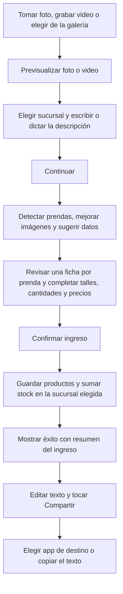

# Bueno Bonito y Barato · Ingreso de mercadería desde el celular

> La dueña prepara las fotos como parte de su rutina de promoción. Desde el mismo celular puede aprovechar esa captura para cargar el catálogo, sumar el stock de la sucursal y compartir la novedad.

- El catálogo es común a las tres sucursales. 
- Cada producto tiene un código único y dos precios, minorista y mayorista. 
- Cada combinación de producto y talle tiene su propio saldo en cada sucursal.
 - En la demo, un ingreso corresponde a una sola sucursal. 
 - Durante la revisión, cada prenda se puede cargar como producto nuevo o vincular a uno existente si es una reposición.

| Dato | Cómo llega a la ficha |
| --- | --- |
| Imagen | El asistente mejora la foto original o un fotograma del video para cada prenda. La dueña puede elegir la captura original o la versión mejorada. |
| Nombre, código y descripción del catálogo | El asistente los propone. La persona puede editarlos y el sistema verifica que el código de un producto nuevo sea único. Una reposición conserva el código existente. |
| Talles | El asistente los precompleta cuando puede leer una etiqueta o extraerlos de la nota. La persona los valida o agrega. |
| Cantidad ingresada por talle | La persona la carga o verifica si estaba indicada en la nota. Cada línea confirmada registra un entero positivo. |
| Precio minorista y mayorista | Se precompletan a partir de la nota cuando están explícitos. Una reposición muestra los precios vigentes del producto. La persona completa los faltantes. |
| Texto para compartir | Se prepara a partir de los datos confirmados y se puede editar en la pantalla de éxito. |

La nota de ingreso es el campo «Descripción» de la primera pantalla. Puede mezclar detalles, cantidades y precios. La descripción del catálogo pertenece a cada producto. El texto para compartir puede reunir varias prendas de un mismo ingreso.

## Recorrido de la PWA en Android

Mientras el ingreso está en borrador, sus fichas se pueden corregir, agregar o quitar. Si el asistente no identifica una prenda, la persona puede armar su ficha con la captura original. Al confirmar se guardan juntos los productos nuevos y el ingreso de stock. Un reintento o un doble toque sobre «Confirmar ingreso» registra las unidades una sola vez. La pantalla de éxito muestra la sucursal, la cantidad de productos y el total de unidades, con las imágenes y el texto listos para compartir. El botón «Compartir» abre el selector de Android y la opción «Copiar texto» permite pegar la descripción en WhatsApp, Instagram o Facebook.

## Escenario para mostrarle a la dueña

La dueña graba un video de una remera y un pantalón, selecciona una de las tres sucursales y dicta sus talles y precios. La PWA devuelve dos fichas con una imagen mejorada por prenda. Ella revisa las sugerencias y carga las cantidades. Si ya había 5 remeras talle M en esa sucursal y llegaron 12, la confirmación deja 17 allí. En la misma pantalla puede tomar el texto de promoción y compartir la novedad con sus clientes.
